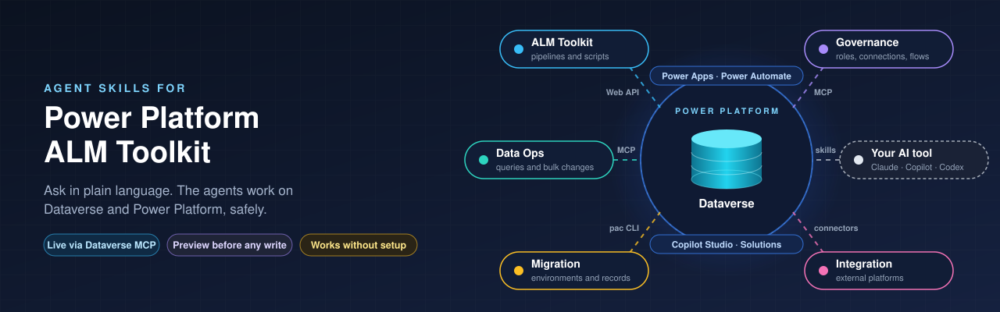

<p align="center">
  
</p>

# Power Platform ALM Toolkit

[](https://github.com/NaveenGaneshe/power-platform-alm-toolkit-skill/actions/workflows/ci.yml)
[](LICENSE)
[-6f42c1)](https://agentskills.io/specification)


**Five AI agents that turn your assistant into a careful Power Platform expert.** Ask in plain
language, in Claude, GitHub Copilot, Codex, Cursor, Gemini or a chat assistant. They query your
Dataverse data, audit your environments, move and connect your data, and build your ALM pipelines.
Nothing changes without your OK.

## Meet the agents

| | Agent | In one line |
|---|---|---|
| 🔎 | [**Data Ops**](#data-ops) | Ask your data anything, and change it safely. |
| 🛡️ | [**Governance**](#governance) | A health check for your environments. |
| 🚚 | [**Migration**](#migration) | Lift and shift, always with a way back. |
| 🔗 | [**Integration**](#integration) | Connect Dataverse to the rest of your business. |
| 🏗️ | [**ALM Toolkit**](#alm-toolkit) | Pipelines, scripts and runbooks you keep in Git. |

You never need to name an agent. Describe what you want, and the right one picks up the request.

---

<a id="data-ops"></a>

### 🔎 Data Ops Agent

**Ask your data anything, and change it safely.** · [`pp-data-ops-agent`](skills/pp-data-ops-agent)

- **Answers questions in plain language:** counts, lists, lookups and trends, with no SQL or FetchXML to write.
- **Bulk changes with a preview:** update, deactivate or delete many records, after seeing the count, a sample and the old → new values.
- **Deletes need a second, separate confirmation.**
- **Handles big tables:** pages through large data sets and keeps live calls few, so it stays fast and cheap.

> *"Deactivate every case open more than 90 days. Show me a preview first."*

<a id="governance"></a>

### 🛡️ Governance Agent

**A health check for your environments.** · [`pp-governance-agent`](skills/pp-governance-agent)

- **Security role drift:** who has System Administrator in production but not in dev, and every other mismatch between environments.
- **Connection reference health:** finds references that were never connected or are broken, and says clearly when something can't be verified rather than guessing.
- **Flow health after an import:** finds flows that didn't turn back on and traces each one to its cause.
- **Fixes only on your confirmation,** and never turns a flow on while a connection it needs is still broken.
- **Runs every night if you want:** a [scheduled GitHub Actions check](docs/scheduled-governance-check.md) files the report as an issue.

> *"Why won't my flows turn on after the import?"*

<a id="migration"></a>

### 🚚 Migration Agent

**Lift and shift, always with a way back.** · [`pp-migration-agent`](skills/pp-migration-agent)

- **Copy an environment** within the same tenant.
- **Move to a new tenant:** one environment or the whole tenant, walked through step by step.
- **Move related records together:** accounts with their contacts and open opportunities, with every relationship intact.
- **Load data from an old system:** removes duplicates, matches existing records, transforms fields and supports repeat runs.
- **States the backup and rollback plan before anything moves.**

> *"Move these accounts, their contacts and their open opportunities to the new environment."*

<a id="integration"></a>

### 🔗 Integration Agent

**Connect Dataverse to the rest of your business.** · [`pp-integration-agent`](skills/pp-integration-agent)

- **Any business platform:** CRM, accounting, e-commerce, marketing, support and more.
- **Maps related data in the right order,** so customers exist before the orders and invoices that point to them.
- **Picks the connector:** uses a certified connector when there is one, or designs a custom connector.
- **Sets up sync tables on your OK,** for logs, queues and connection details, and never stores a secret in them.
- **No duplicates, even on retry:** every write is safe to repeat.
- **Designs the live sync** in Power Automate, and suggests Azure services only when you outgrow it.

> *"Sync our invoices to the accounting system automatically, with no duplicates."*

<a id="alm-toolkit"></a>

### 🏗️ ALM Toolkit

**Pipelines, scripts and runbooks you keep in Git.** · [`power-platform-alm-toolkit`](skills/power-platform-alm-toolkit)

- **Complete GitHub Actions pipelines:** export, unpack, validate, version, pack, deploy to test, wait for approval, deploy to production.
- **Deploys across tenants,** for example from a vendor's tenant into your corporate tenant, which built-in Power Platform pipelines can't do.
- **Safe operation scripts:** a test run is on by default, records are saved before they change, and every run can be undone.
- **A button for admins:** each operation gets a simple "Run workflow" form and a plain-language runbook.

> *"Build a pipeline that promotes our HRCore solution from dev to UAT to production, with manager approval."*

---

## Built in to every agent

- ✅ **Works with or without a live connection.** Connected to Dataverse, the agents answer and act right away. Not connected, they hand you a ready-to-run query, script or runbook. No setup needed to start.
- ✅ **Preview first, then your OK.** Nothing changes until you've seen exactly what will change and confirmed it.
- ✅ **A way back.** The undo or rollback path is stated before anything runs.
- ✅ **Cost-smart.** Live Dataverse calls are billed in Copilot Credits, so the agents count before they fetch, keep calls few, and tell you before a heavy run.
- ✅ **No guessing.** Commands, API calls and table names come from verified reference files. When something can't be verified, the agent says so.

## Get started

**1. Install.** Pick the line for your setup:

```bash
# Claude Code, Codex, GitHub Copilot, Cursor, Gemini CLI and many more (needs Node.js 18+)
npx skills add NaveenGaneshe/power-platform-alm-toolkit-skill

# macOS / Linux, without Node.js
curl -fsSL https://raw.githubusercontent.com/NaveenGaneshe/power-platform-alm-toolkit-skill/main/scripts/install.sh | bash -s -- --tool all
```

```powershell
# Windows
& ([scriptblock]::Create((irm https://raw.githubusercontent.com/NaveenGaneshe/power-platform-alm-toolkit-skill/main/scripts/install.ps1))) -Tool all
```

Using claude.ai, ChatGPT, Gemini or Copilot Studio? See the [installation guide](docs/installation.md)
for every option.

**2. Ask something.** Start a new session and try *"How many contacts have no email address?"*.
Without a live connection, you get a query you can run yourself.

**3. Connect live (optional).** To get answers straight from your environment, connect the
Dataverse MCP server. An admin allows it once per environment, and Microsoft bills these calls in
[Copilot Credits](https://learn.microsoft.com/power-apps/maker/data-platform/data-platform-mcp).
The [installation guide](docs/installation.md#connect-to-dataverse-for-live-answers-optional) has
the steps.

## Learn more

- [User guide](docs/user-guide.md): how to ask so you get a good result first time, and more about each agent.
- [Prompt library](examples/prompts.md): copy-paste prompts for every agent.
- [Installation guide](docs/installation.md): every AI tool, and connecting to Dataverse.
- [Scheduled governance check](docs/scheduled-governance-check.md): the governance checks every night, as a GitHub issue.
- [Contributing](CONTRIBUTING.md): repository layout, local checks and how to propose changes.

## Good to know

This is a community project. It is not affiliated with, endorsed by, or supported by Microsoft,
Anthropic, OpenAI, GitHub or Google. AI output can be wrong: review it, try it in a non-production
environment first, and keep the test-run defaults on until you trust it. Microsoft, Power Platform,
Dataverse, Power Automate, Power Apps and Dynamics 365 are trademarks of the Microsoft group of
companies.

Report security issues privately, as described in [SECURITY.md](SECURITY.md).
Licensed under [MIT](LICENSE).
